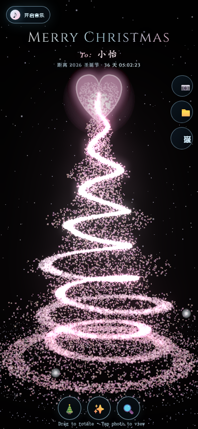
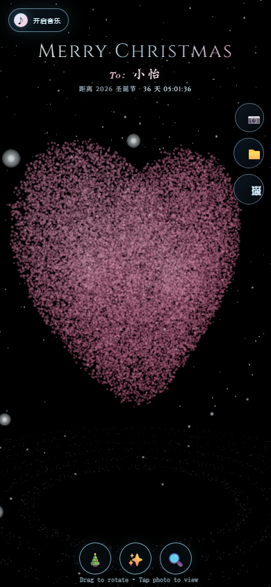

# 小怡的圣诞树

一棵全屏粒子圣诞树，支持圣诞倒计时、手势控制、照片上传和背景音乐。

## 效果

## 使用

页面需要通过 HTTPS 静态服务器访问，GitHub Pages 可直接运行。

- 点击底部 ✨、双击屏幕或张开手掌，粒子会展开成立体爱心。
- 左上角按钮控制背景音乐；手机浏览器首次需要用户点击后才能播放。
- 点击摄像头按钮会先请求权限并开启画面，手势模型随后在后台加载。
- 移动端会按安全区和屏幕尺寸自动适配。

## 文件

- `index.html`：网页主文件
- `heart-density.js`：爱心粒子轮廓数据
- `audio/christmas.mp3`：背景音乐
- `preview.png`、`preview-heart.png`：预览图

页面中的全部交互与粒子效果在浏览器本地运行。
